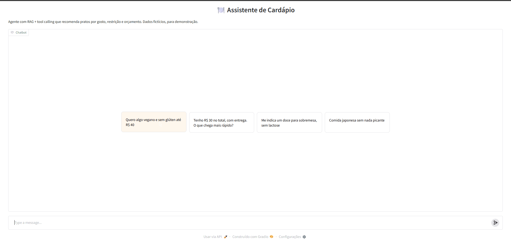

# 🍽️ Assistente de Cardápio — RAG + Tool Calling


Agente de IA que recomenda pratos de delivery a partir de pedidos em linguagem natural, como
*"quero algo vegano e sem glúten até R$ 40"*, combinando **busca semântica** com
**ferramentas determinísticas** para preço, frete e tempo de entrega.

🔗 **Demo:** [huggingface.co/spaces/Cleber-Victor/assistente-cardapio](https://huggingface.co/spaces/Cleber-Victor/assistente-cardapio)

<!-- Coloque aqui um GIF de 10–20s usando o app:  -->

## O problema

Em apps de delivery, quem tem restrição alimentar ou orçamento apertado precisa abrir vários
restaurantes e ler cardápios um a um. Um chatbot "puro" resolveria a conversa, mas **LLMs
inventam preços e pratos**. O desafio aqui é ter a flexibilidade da linguagem natural sem
perder a confiabilidade dos dados.

## A solução

```
Usuário ──► LLM (gpt-oss-120b via Groq)
              │  decide quais ferramentas chamar
              ▼
   ┌──────────────────────┬───────────────────┬──────────────────────┐
   │ buscar_pratos        │ calcular_entrega  │ detalhes_restaurante │
   │ embeddings + filtros │ fórmula testada   │ cardápio completo    │
   └──────────────────────┴───────────────────┴──────────────────────┘
              │  resultados em JSON
              ▼
          LLM explica a recomendação ──► Usuário
```

**Decisões de design:**

| Decisão | Por quê |
|---|---|
| **Filtro duro antes da busca semântica** | Restrição alimentar não pode ser "aproximada": um prato com carne nunca deve aparecer para quem pediu vegano, mesmo que a descrição pareça similar. |
| **Números só vêm das ferramentas** | Preço, frete e tempo são calculados em código testado. O LLM só escolhe a ferramenta e explica o resultado, o que reduz alucinação. |
| **Embedder injetável** | Produção usa `paraphrase-multilingual-MiniLM-L12-v2` (entende português). Os testes usam um embedder por hashing, então rodam em 0,1s, sem internet. |
| **API compatível com OpenAI** | Troca de provedor (Groq, OpenAI, OpenRouter, Ollama local) só com variáveis de ambiente. |
| **Erros de ferramenta voltam ao modelo** | JSON inválido ou ID inexistente vira mensagem de erro para o LLM se corrigir, em vez de derrubar o app. |
| **Ferramentas usadas ficam visíveis** | A interface mostra cada chamada, o que deixa o raciocínio do agente auditável. |

## Stack

Python · Gradio · sentence-transformers · NumPy · OpenAI SDK (Groq) · pytest · GitHub Actions · Hugging Face Spaces

## Como rodar

```bash
git clone https://github.com/Cleber-Victor/assistente-cardapio
cd assistente-cardapio
python -m venv .venv && source .venv/bin/activate   # Windows: .venv\Scripts\activate
pip install -r requirements.txt
cp .env.example .env    # coloque sua chave gratuita do Groq
python app.py           # abre em http://127.0.0.1:7860
```

Testes: `pytest -q`

## Estrutura

```
├── app.py               # interface Gradio
├── data/cardapio.json   # 10 restaurantes e 35 pratos fictícios
├── src/
│   ├── retriever.py     # busca semântica + filtros
│   ├── tools.py         # ferramentas e schemas para o LLM
│   └── agent.py         # loop de tool calling
└── tests/               # testes das ferramentas e do loop do agente (LLM falso)
```

## Limitações e próximos passos

- [ ] **Evals:** conjunto de perguntas com respostas esperadas para medir acerto e alucinação a cada mudança
- [ ] Dataset real, com mais itens, e índice vetorial (FAISS) para escalar
- [ ] Memória de preferências do usuário entre conversas
- [ ] Ferramenta de "montar carrinho" com soma do total e frete

---
*Dados 100% fictícios, criados para demonstração. Projeto pessoal, sem vínculo com nenhuma empresa.*
